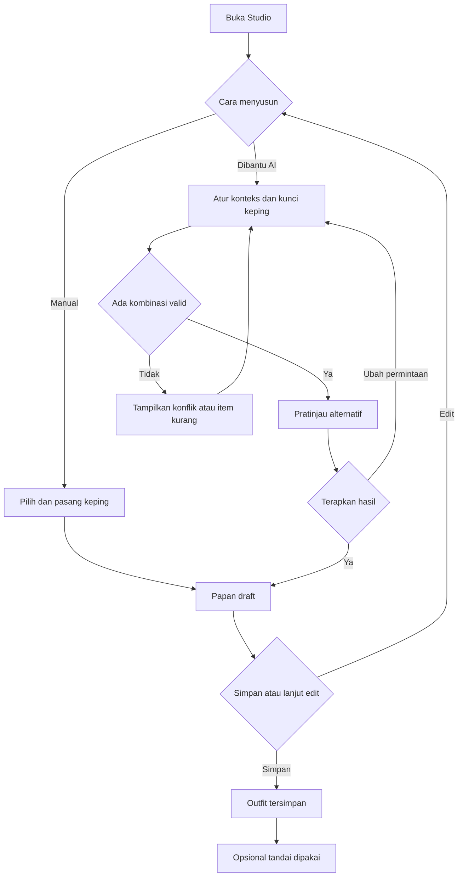
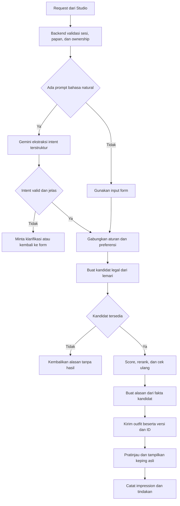
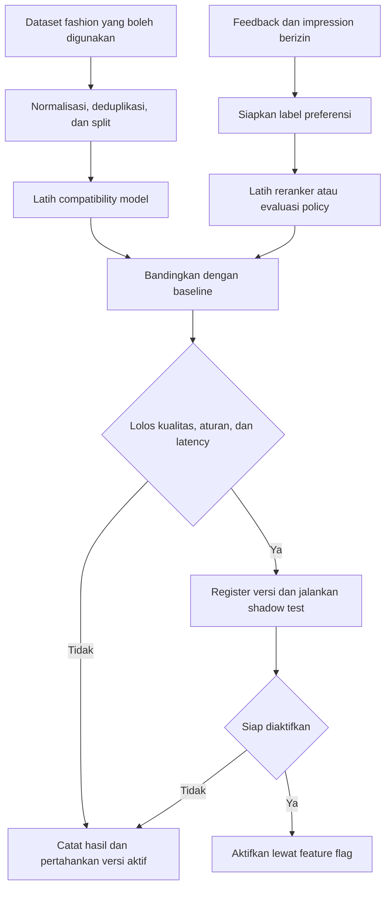
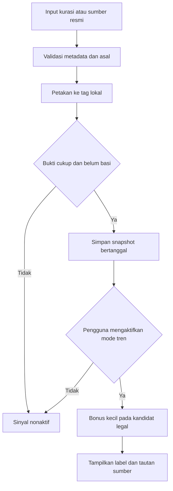

# Outfit Puzzle — Brief Produk dan Spesifikasi Teknis untuk Codex

**Status:** Draft implementasi v0.1 · 16 November 2026 · Bahasa produk utama: Indonesia  
**Pengguna awal:** Founder sebagai pengguna pertama, kemudian beta kecil pengguna Indonesia.  
**Tujuan dokumen:** Bisa diberikan langsung ke Codex sebagai spesifikasi produk, sistem, dan urutan implementasi. Nama *Outfit Puzzle* adalah working name.

> Bangun website untuk menyusun outfit dari pakaian yang benar-benar dimiliki. Setiap item menjadi kepingan visual. Pengguna bisa merakit sendiri, meminta sistem melengkapi kepingan tertentu, atau meminta outfit lengkap lewat bahasa natural. Rekomendasi dapat diedit di papan yang sama.

## 0. Instruksi singkat untuk Codex

1. Baca brief ini dan aturan repositori terlebih dahulu. Jika repo sudah ada, identifikasi stack dan konvensinya. Jangan mengganti arsitektur yang sudah dipakai tanpa alasan.
2. Pada eksekusi pertama, kerjakan **Milestone 1 saja** sesuai definisi selesai di `12. Tampilkan rencana singkat, lalu implementasikan, jalankan pengujian, dan tunjukkan cara menjalankannya. Milestone selanjutnya adalah roadmap, bukan perintah untuk membangun semuanya sekaligus.
3. Jika repo kosong gunakan default di `5. Gunakan data demo fiktif dan aset buatan sendiri yang ringan. Aplikasi pertama harus bisa berjalan tanpa akun Supabase aktif, token Gemini, model terlatih, atau jaringan eksternal.
4. Buat kontrak domain sekali dan gunakan di UI, API, ranker, serta tes. Stub harus diberi label demo. Jangan menyamarkan rules sebagai model yang sudah dilatih, mengarang skor model atau data tren, atau menyatakan tes lulus tanpa menjalankannya.
5. Simpan asumsi dan keputusan yang menyimpang dari brief di `docs/decisions/`. Tanyakan hanya jika keputusan yang belum ada menghalangi implementasi atau mengubah perilaku inti.
6. Jangan commit secret, deploy ke produksi, menyalakan layanan berbayar, atau mengumpulkan dataset eksternal tanpa keputusan terpisah. Default yang dipakai dalam draft ini dapat direvisi tanpa mengubah tujuan produk.

## 1. Problem statement dan keputusan produk

**Masalah:** Inspirasi outfit mudah ditemukan di TikTok, Pinterest, dan media sosial, tetapi pengguna masih perlu menerjemahkannya ke pakaian yang benar-benar ada di lemari, sesuai acara, dan sesuai selera. Perencanaan manual memakan langkah yang sama berulang kali. Mengisi seluruh lemari justru bisa menjadi beban awal.

**Janji produk:** *“Mulai dari satu keping yang ingin kamu pakai. Susun sendiri atau minta AI melengkapi sisanya dari pakaianmu.”*

**Pembeda yang diuji:** Satu siklus **rakit → kunci → lengkapi → ganti satu keping → simpan → tandai dipakai**. Kolase membantu keputusan. Tren memberi konteks dan tidak menjadi sumber pakaian fiktif. AI membantu memahami maksud, sedangkan model milik produk menilai kecocokan dan mengurutkan pilihan. Ini hipotesis diferensiasi, bukan klaim belum ada pesaing.

**Use case awal:**

- *“Presentasi besok. Atasan wajib putih, jeans hitam tetap, jangan terlalu formal.”* → filter ketat untuk warna dan jeans, preferensi lunak untuk formalitas. Jika ada pilihan, isi dari lemari dan jelaskan alasannya.
- *“Kunci kemeja navy dan celana cream. Coba ganti sepatunya saja.”* → hanya slot sepatu boleh berubah.
- *“Aku ingin nuansa earth tone, pakai baju yang ada.”* → gunakan tag palet sebagai preferensi. Jika tidak ada kombinasi yang mendekati, jelaskan tanpa menambahkan produk dari luar.
- *“Aku mau menyusun outfit sendiri.”* → interaksi tetap berjalan tanpa Gemini, layanan rekomendasi, atau sinyal tren.

| Kelas | Termasuk | Di luar kelas tersebut |
|---|---|---|
| Prototipe lokal | Lemari seed, puzzle manual, partial/full recommendation lewat form, baseline deterministik, simpan dan riwayat aksi lokal | Login, cloud, Gemini, gambar generatif |
| MVP personal | Supabase Auth dan Storage privat, CRUD, sinkronisasi, Gemini NLP dan penjelasan terstruktur, umpan balik, kolase foto asli | Pembayaran, feed sosial, scraping tren, virtual try-on |
| MVP dengan ML | Model compatibility hasil training sendiri, reranker preferensi, evaluasi baseline vs model, sinyal tren berbasis kurasi | Belajar online langsung dari setiap tindakan |
| Eksperimen setelah MVP | Bandit, trend ingestion resmi, background removal otomatis, visual generatif dan mode perjalanan | Masing-masing feature flag tersendiri |

**Verifikasi produk:** Ukur waktu dari memilih konteks ke outfit yang diterima, keberhasilan menentukan pilihan, jumlah tindakan *dipakai*, kembali pada hari berbeda, dan waktu memasukkan lima item pertama. Uji awal pada kasus sendiri, lalu 5–8 pengguna. Bandingkan dengan kebiasaan lama (buka lemari, chat, atau referensi sosial). Angka kecil memberi temuan kualitatif, bukan bukti retensi pasar.

## 2. Desain puzzle dan kolase

### 2.1 Model editor

- **Papan memiliki slot semantik**, bukan kanvas posisi bebas. Template awal `separates_v1` memiliki `top`, `bottom`, `shoes` yang wajib untuk outfit lengkap, dan `outer` opsional. Draft boleh belum lengkap. Bentuk kepingan dibuat dengan CSS/SVG, tetapi tidak perlu geometri yang saling mengunci secara literal.
- Rak lemari punya pencarian dan filter kategori. Item bisa ditambahkan melalui drag-and-drop, tap item lalu pilih slot, atau keyboard. Drag visual bukan satu-satunya jalur, khususnya di perangkat sentuh. Tampilkan focus ring, label slot, status terkunci, dan pesan perubahan yang bisa dibaca assistive technology.
- Keping menampilkan foto atau thumbnail transparan jika tersedia, nama, dan kategori. Jika belum ada foto, gunakan swatch, ikon, dan nama. Status item dan slot jangan dibedakan lewat warna saja.
- Satu item hanya dapat mengisi satu slot dalam satu papan. Slot hanya menerima kategori sesuai template. Menaruh item baru pada slot yang sudah berisi dan tidak terkunci akan mengganti item. Salah kategori atau slot terkunci tidak mengubah papan dan menampilkan pesan. Saat pengguna ingin mengganti item terkunci, ia harus membuka kunci terlebih dahulu.
- Dukung hapus slot, undo/redo lokal, dan simpan dengan nama. *Reset papan* mengosongkan slot yang tidak terkunci. *Hapus semua* berbeda dan meminta konfirmasi jika ada keping terkunci. Outfit favorit menjadi pilihan terpisah dari status pernah dipakai.
- Aturan seperti dress code membatasi hasil AI, bukan kebebasan puzzle manual. Mode manual boleh menyimpan kombinasi yang bertentangan dengan dress code yang sedang aktif setelah menampilkan peringatan. Ownership dan tipe slot tetap wajib pada semua mode.
- Template dapat ditambah sesudah alur awal stabil. Misalnya `one_piece_v1` dengan `one_piece` sebagai pengganti top/bottom, dan slot `headwear` atau aksesori jika dibutuhkan. Wardrobe boleh menyimpan tipe ini lebih awal, tetapi editor harus menjelaskan bahwa tipe tersebut belum dapat dipakai di template awal. Jangan membuat janji inklusivitas template yang belum didukung.

### 2.2 Empat aksi rekomendasi

| Aksi | Slot yang boleh berubah | Semantik |
|---|---|---|
| **Lengkapi** / `fill_empty` | Hanya slot kosong | Semua slot berisi dianggap tetap pada request ini, meski UI tidak menguncinya secara permanen. Secara default utamakan mengisi slot wajib. |
| **Susun outfit** / `compose` | Semua slot yang tidak dikunci | Jika papan punya isi yang akan diganti, tampilkan pratinjau, jangan commit otomatis. |
| **Ganti slot** / `replace_slots` | Hanya slot yang dipilih dan tidak dikunci | Slot aktif yang diganti tidak boleh menerima kembali item lama di hasil utama. Jika tidak ada alternatif, kembalikan alasan. |
| **Rakitan manual** | Slot yang diedit dan tidak terkunci | Tidak memerlukan AI. Perubahan masuk undo/redo. |

- Hasil menampilkan maksimum tiga alternatif yang benar-benar berbeda. Klik untuk pratinjau di papan secara non-destruktif. Klik *Terapkan* untuk commit draft, *Simpan outfit* untuk persist, dan *Aku pakai ini* untuk feedback eksplisit.
- Gunakan `boardRevision` atau snapshot lokal. Jika request selesai setelah papan berubah, tandai hasil usang dan tawarkan jalankan lagi. Jangan menimpa edit pengguna yang lebih baru.
- Jika syarat ketat konflik dengan slot tetap, tampilkan konflik spesifik. *“Atasan terkunci saat ini navy, sementara kamu meminta atasan putih.”* Jangan membuka kunci atau menurunkan syarat menjadi preferensi tanpa tindakan pengguna.
- Bila tidak ada kandidat valid, tampilkan pilihan yang dapat dilakukan pengguna, misalnya membuka lock, memperluas pilihan warna, atau memasukkan pakaian lain. Jangan mengarang pengganti.

### 2.3 Tiga tingkat visual

| Tingkat | Output | Kapan dipakai |
|---|---|---|
| **L0 — Puzzle UI** | Keping dengan foto, swatch, dan nama. Tiga area desktop: lemari, papan, panel saran. Mobile: papan dan lemari bertab/drawer. | Prototipe lokal |
| **L1 — Kolase asli** | Foto item yang sama dirender pada posisi template. Gunakan crop yang terkontrol, preserve aspect ratio, dan placeholder saat offline/tidak ada foto. | MVP personal |
| **L2 — Ilustrasi AI** | Aset terpisah dan diberi label “Ilustrasi AI”. Opsional dari item yang telah dipilih, tidak boleh mengganti foto item atau dipakai untuk menjamin ukuran, warna, atau fit. | Eksperimen terpisah |

Untuk L1, mulai dengan HTML/CSS dan gambar inventaris. PNG export bisa ditambahkan ketika memang dibutuhkan. Saat export aktif, gunakan komposisi dengan sumber blob/foto yang diotorisasi dan uji bahwa sumber gambar tidak membuat canvas tidak bisa diekspor. Background removal dimulai dari opsi manual/crop, kemudian bisa menjadi job segmentasi asynchronous dengan tampilan sebelum/sesudah. Simpan foto asli dan turunan secara terpisah. **Kolase tidak membutuhkan LLM untuk memilih posisi visual.**

### 2.4 Layar dan state UX

| Rute usulan | Tujuan | State yang wajib dirancang |
|---|---|---|
| `/wardrobe` | CRUD item, pencarian, filter, upload | kosong, input invalid, foto gagal, foto sedang diproses, item diarsipkan |
| `/studio` | Puzzle, konteks/form, prompt, hasil rekomendasi | papan kosong, draft, loading, usang, tidak ada hasil, Gemini gagal tetapi form tetap berfungsi |
| `/outfits` | Buka kembali, duplikasi, tandai dipakai, arsip | outfit belum ada, item tak tersedia, histori hanya-snapshot |
| `/settings` | Preferensi eksplisit, privasi, preferensi tren | belum diisi, reset preferensi, kontrol penggunaan data untuk peningkatan model |
| `/auth` | Masuk untuk cloud mode | sesi habis, email tidak valid, error provider |

Desain visual awal: editorial fashion dengan latar netral dan fokus pada foto. Hindari dekorasi yang mengalahkan informasi. UI utama Bahasa Indonesia, enum/kode dalam bahasa Inggris. *Dress code* dan alasan perlu bisa dipahami tanpa melihat gambar.

## 3. Diagram alur

### 3.1 Alur pengguna



### 3.2 Jalur rekomendasi saat runtime



### 3.3 Pembelajaran model dan rilis



### 3.4 Alur sinyal tren



## 4. Domain, state, dan aturan yang tidak boleh dilanggar

Istilah utama:

| Istilah | Arti |
|---|---|
| `ClothingItem` | Satu item fisik milik satu pengguna. Dua kemeja putih bisa punya ID berbeda. |
| `BoardDraft` | Snapshot papan editable, termasuk slot kosong, item, dan locks. |
| `OutfitCandidate` | Kombinasi legal untuk request tertentu, dengan ID kandidat unik di sesi itu. |
| `Outfit` | Rakitan tersimpan. Versi item outfit tetap dapat direferensikan saat dipakai dan dianalisis. |
| `StyleIntent` | Representasi terstruktur dari prompt atau form. Bukan instruksi yang langsung dieksekusi. |
| `Impression` | Kandidat yang benar-benar ditampilkan pada pengguna, bukan kandidat yang hanya dihitung server. |
| `FeedbackEvent` | Aksi yang dikaitkan ke outfit atau impression. Aksi manual dibedakan dari respons terhadap rekomendasi. |

**Invarian:** AI hanya memilih ID milik pengguna yang masih tersedia dan cocok dengan tipe slot. Tidak boleh ada duplikasi item, penggantian slot tetap, pelanggaran aturan eksplisit, atau pemakaian pakaian diarsipkan pada rekomendasi baru. Backend menegakkan invarian bahkan jika UI, Gemini, atau model ML memberi input salah. Model ML tidak mendapat hak menulis langsung ke lemari, outfit, atau database.

**Atribut item minimal:** `id`, `name`, `category`, `primaryColor`, `status`. Opsional: `secondaryColors`, `formality` (ordinal 1–5), `pattern`, `material`, `layerWarmth`, `styleTags`, `photoRef`. Simpan warna kanonis untuk filter dan label bebas untuk tampilan. Contoh `white` berbeda dari `ivory`, kecuali pengguna memilih keduanya. Nilai tak diketahui disimpan sebagai `null`, bukan ditebak. Untuk aturan ketat, atribut tak diketahui tidak dianggap memenuhi aturan.

**Konteks awal:** `occasion`, aturan slot (kategori/warna), level formalitas yang diinginkan, preferensi tag/palet, item terkunci, ID yang dikecualikan, dan `trendMode` yang default mati. Cuaca awal cukup input manual *panas / sejuk / dingin / hujan*. Integrasi cuaca atau kalender adalah fitur tersendiri.

**Precedence:** Validasi sesi, kategori dan availability → aturan keras dari pengguna (lock, exclusions, kewajiban) → preferensi konteks dan selera → skor tren opsional. Jika form eksplisit dan prompt memberikan dua aturan keras yang bertentangan, minta klarifikasi. Jangan diam-diam memilih salah satu. Kekurangan keping yang membuat outfit tidak lengkap adalah status produk yang sah. MVP tidak mengembalikan outfit tidak lengkap dengan label “lengkap”.

**Kontrak inti awal:** Contoh TypeScript berikut menetapkan bentuk data pada batas editor dan ranker untuk `separates_v1`. Pada template baru, tambah kontrak berversi. Nilai pada slot wajib tidak boleh `null` pada kandidat yang dikirim.

```ts
type Slot = 'top' | 'bottom' | 'shoes' | 'outer';
type ItemStatus = 'available' | 'unavailable' | 'archived';
type Mode = 'fill_empty' | 'compose' | 'replace_slots';
type SlotMap = Record<Slot, string | null>;

interface BoardDraftV1 {
  templateId: 'separates_v1';
  revision: number;
  slots: SlotMap;
  lockedSlots: Slot[];
}

interface LegalCandidateV1 {
  id: string;
  slots: { top: string; bottom: string; shoes: string; outer: string | null };
}

interface CompatibilityRanker {
  readonly version: string;
  scoreBatch(
    candidates: readonly LegalCandidateV1[],
    features: ReadonlyMap<string, readonly number[]>
  ): Promise<ReadonlyMap<string, number>>;
}
```

Adapter menerima fitur yang sudah dibentuk sesuai feature schema. Hasil harus punya satu skor finite per kandidat yang diberikan dan tidak boleh memuat ID tambahan. Pengurutan akhir tetap di orchestrator. UI boleh memuat hanya ID kandidat, lalu memetakan metadata dari lemari yang sudah dimiliki, dengan fallback ke snapshot saat membuka outfit lama.

## 5. Arsitektur dan struktur repo

### 5.1 Default implementasi

| Layer | Pilihan | Batas tanggung jawab |
|---|---|---|
| Web | React + TypeScript + Vite. CSS sesuai repo. dnd-kit boleh dipakai bila membantu, tetap sediakan kontrol tap dan keyboard. | Editor, presentasi, sesi, state lokal. |
| Domain | TypeScript murni + validator seperti Zod pada batas input/output. | Enum, aturan slot, validasi domain, generator/ranker baseline dan fixture. |
| Layanan HTTP | Node.js + TypeScript, misalnya Fastify. Mulai Milestone 2. | Auth guard, request orchestration, Gemini, logging, rate limit, penyimpanan rekomendasi dan feedback. |
| Data | Supabase Auth, Postgres, Storage privat, migration SQL di repo. Mulai Milestone 2. | Data pengguna, consent, data referensi, storage. |
| ML | Python untuk preprocessing dan training. Baseline ML sederhana yang dapat diekspor. Mount ranker terlatih lewat adapter dengan kontrak skor per kandidat. | Training offline. Belum perlu layanan Python terus menyala jika model bisa dibaca proses Node. |
| Testing | Vitest untuk domain/komponen, Playwright untuk flow web, pytest untuk training. | Jangan memanggil provider berbayar dalam CI default. |

**Kenapa bukan banyak microservice?** Milestone 1 cukup satu web repo dengan dependency injection sederhana. Milestone 2 menambah satu backend. Saat Milestone 3, model linear/kompak bisa diekspor dengan urutan fitur, normalizer, bobot, dan versi sebagai JSON. Jika model visual berat memang terbukti membantu, pindahkan inferensinya ke layanan privat Python/FastAPI sebagai keputusan deployment terpisah. Samakan preprocessing train/serve dan cek parity pada fixture sebelum rilis.

### 5.2 Tata letak usulan

```text
apps/
  web/                 # React: wardrobe, studio, outfits, auth, settings
  api/                 # M2: HTTP routes, auth, adapters, storage coordination
packages/
  domain/              # shared types, schemas, rules, request invariants
  recommender/         # candidate generator, baseline, rerank, ranker interface
supabase/
  migrations/
  seed.sql             # hanya fixture atau data demo, tanpa data pribadi
ml/
  configs/
  src/                 # prepare, train, evaluate, export
  tests/
docs/
  decisions/
  model-cards/
  data-dictionary.md
tests/
  e2e/
```

Setup awal gunakan satu package manager dan satu lockfile. Expose script `dev`, `test`, `lint`, `typecheck`, `build`, dan `test:e2e`. Lengkapi README dengan setup demo tanpa secret. `.env.example` hanya placeholder. Variabel browser hanya URL dan publishable key Supabase bila dibutuhkan. `GEMINI_API_KEY`, dan bila dibutuhkan key admin Supabase, hanya di server. Pilihan model diletakkan di konfigurasi server dan dicatat di log teknis tanpa mencatat secret.

### 5.3 Boundary auth, storage, dan fitur

- Prototipe memakai repository lokal. Sistem web MVP memakai repository Supabase tanpa mengubah domain. Jalur demo dan cloud dipisah jelas. Jangan unggah data demo atau data pribadi lama otomatis ketika masuk.
- Verifikasi token/sesi di backend. Untuk query atas nama pengguna, gunakan client yang membawa JWT user sehingga RLS tetap berlaku. Role admin hanya untuk maintenance yang sempit, tidak dipakai sebagai jalan pintas untuk operasi normal.
- Supabase RLS memakai `auth.uid() = user_id` pada operasi owner, termasuk `WITH CHECK` untuk write. Child records direferensikan dengan pasangan `(user_id, id)` atau cek ownership yang ekuivalen. Jangan percaya `user_id` kiriman client. Field ownership tidak bisa diubah lewat API produk.
- Bucket privat `wardrobe-images`, path `<user_id>/<item_id>/<asset_id>.webp`, akses pendek melalui signed URL atau download authorized. Simpan storage key, bukan signed URL. Lakukan validasi jenis file berdasarkan decode yang aman, bukan ekstensi, dan pasang batas ukuran dan dimensi. Re-encode gambar untuk membuang metadata yang tidak diperlukan. Tangani HEIC dengan pesan jelas atau konversi bila sudah didukung.
- Referensi foto untuk Gemini hanya dikirim saat fitur tagging atau visualisasi sengaja diaktifkan. Untuk prompt rekomendasi dan penjelasan, metadata dan ID alias cukup. Jangan kirim lokasi presisi, foto lemari, histori penuh, rahasia, atau identitas jika tidak dibutuhkan.
- Kontrol terpisah: `USE_GEMINI_NLP`, `USE_CUSTOM_RANKER`, `USE_TRENDS`, `USE_IMAGE_AUTOTAG`, `USE_GENERATIVE_IMAGE`, `USE_BANDIT`. Gunakan default off pada fitur yang belum tersedia. Perilaku fallback tetap jelas di UI.

## 6. Supabase — skema logis v1

Ini kontrak logis. Buat DDL dan tes migrasi pada Milestone 2. Gunakan UUID untuk entity pemilik, `timestamptz` untuk audit, dan JSONB hanya untuk payload yang memang memiliki schema version. Kolom timestamps umum dihilangkan dari tabel ringkas.

| Tabel | Kolom inti dan fungsi |
|---|---|
| `profiles` | `id` sama dengan `auth.users.id`, `locale`, `timezone`. Simpan data yang benar-benar diperlukan. |
| `clothing_items` | `id`, `user_id`, atribut domain `4, `status` (available/unavailable/archived), `archived_at`. Index `(user_id, status, category)`. |
| `clothing_assets` | `id`, `user_id`, `item_id`, `variant` (original/thumb/cutout), `object_key` unik, mime, dimensions, status. FK ownership ke item. |
| `outfits` | `id`, `user_id`, `title`, `template_id`, `version`, `status` (draft/saved/archived), `source` (manual/ai/mixed). |
| `outfit_items` | `user_id`, `outfit_id`, `slot`, `item_id` (nullable jika item dihapus dan snapshot dipertahankan), `is_locked`, `item_snapshot` berisi metadata tampilan tanpa URL permanen. Unik per slot, dan unik per item non-null per outfit. |
| `user_preferences` | `user_id`, tag dan palet disukai/dihindari, override konteks, `trend_opt_in`, `schema_version`. Preferensi baru belum berarti persetujuan penggunaan data untuk melatih model global. |
| `recommendation_sessions` | `id`, `user_id`, `board_revision`, konteks terstruktur yang sudah diminimalkan, mode, model/policy/intent version, snapshot tren, request timestamp dan status. Jangan simpan raw prompt secara default. |
| `recommendation_candidates` | `id`, `session_id`, `user_id`, payload item/slot berversi, rank, keterkaitan kandidat, reason codes, skor komponen internal. Simpan yang dikirim ke client. Jika eksperimen bandit aktif, simpan juga deskripsi action set yang dibutuhkan untuk evaluasi. |
| `recommendation_impressions` | `id`, `candidate_id`, `session_id`, `user_id`, `surface`, `position`, `shown_at`, `propensity` nullable. Propensity hanya diisi jika policy benar-benar menentukan probabilitas sesuai unit eksperimen. Dedup posisi/kandidat per sesi dan surface. |
| `feedback_events` | `id`, `user_id`, `event_key`, `event_type`, `outfit_id?`, `outfit_fingerprint?`, `impression_id?`, `slot?`, `reason_code?`, `event_at` dan server time. Unik `(user_id,event_key)` untuk retry. |
| `wear_logs` | `id`, `user_id`, `outfit_id`, `outfit_version`, `slot_snapshot`, `worn_date` sesuai timezone user. Satu log per versi outfit/tanggal untuk MVP. Bisa dibatalkan. |
| `trend_signals` | Data kurasi: `tag`, `region`, `observed_from/to`, `expires_at`, `origin`, `source_url`, `confidence`, `strength`, `snapshot_id`, `status`. Hanya snapshot published dapat dibaca runtime produk. |
| `model_registry` | `model_version`, `feature_schema_version`, `dataset_manifest_id`, hash artefak, artifact reference, metrics, state (shadow/active/retired). Internal. |
| `training_consents` | `user_id`, `scope`, `status`, `policy_version`, timestamp terima/cabut. Dipakai untuk filter ekspor feedback training, bukan untuk memblokir fitur dasar. |

**Konsistensi:** simpan outfit dan itemnya dalam satu transaksi. Cek `expectedVersion` pada edit tersimpan agar tidak kehilangan perubahan. Gunakan soft archive untuk mengeluarkan item dari rekomendasi baru. Saat membuka outfit lama, tunjukkan item yang diarsipkan atau tinggal snapshot. Jangan otomatis mengganti foto/item lama dengan item berbeda. Penghapusan yang diminta pengguna juga menghapus aset turunannya dan menindaklanjuti penggunaan data sesuai kebijakan produk. Data runtime untuk fungsi aplikasi dan data ekspor training dipisah.

**Jalur logging:** backend membuat sesi dan kandidat yang dikirim. Client mengakui kandidat yang benar-benar muncul, backend memverifikasi kepemilikan dan mencatat impression secara idempotent. Feedback tidak boleh diasosiasikan dengan kandidat lain hanya karena ada kemiripan. Jika outfit telah banyak diubah, simpan aksi sebagai mixed dan catat slot yang dipertahankan, bukan memberi kredit penuh pada outfit asli.

## 7. Kontrak API v1

Kolom owner diturunkan dari auth. Semua JSON menggunakan enum dan skema tervalidasi. Untuk prototipe, sediakan fungsi lokal dengan kontrak rekomendasi yang sama, bukan memalsukan REST service. Untuk cloud MVP, rute REST menyederhanakan tanggung jawab. Upload bisa menggunakan signed upload ke Supabase setelah backend memverifikasi item dan memberi path yang dibatasi.

| Endpoint | Tujuan |
|---|---|
| `GET /api/v1/wardrobe` | Daftar item sendiri dengan filter kategori, status, pagination. |
| `POST /api/v1/wardrobe` · `PATCH /api/v1/wardrobe/:id` | Buat/edit/arsip item. Validasi metadata dan ownership. |
| `POST /api/v1/wardrobe/:id/assets` | Buat upload terotorisasi. Asset belum ready sebelum dicek/finalize. |
| `POST /api/v1/wardrobe/:id/assets/:assetId/finalize` | Cocokkan objek yang diunggah, validasi atau antrekan proses, ubah state. |
| `POST /api/v1/recommendations` | Validasi papan, resolve intent, hitung dan kirim kandidat. |
| `POST /api/v1/recommendations/:id/impressions` | Catat kandidat terkirim yang benar-benar dirender. |
| `POST /api/v1/feedback` | Simpan aksi dengan idempotency key, ownership, dan provenance. |
| `GET /api/v1/outfits` · `POST /api/v1/outfits` · `PATCH /api/v1/outfits/:id` | Baca, simpan, dan edit outfit secara transaksional. |
| `POST /api/v1/outfits/:id/wear-logs` | Tandai outfit dipakai pada tanggal dan versi tertentu. |
| `GET /api/v1/trends` | Daftar snapshot aktif dan provenance. Hanya setelah feature flag tren aktif. |

Cuplikan body request `POST /api/v1/recommendations`. ID contoh disingkat agar dibaca, schema produksi memakai UUID.

```json
{
  "mode": "fill_empty",
  "board": {
    "templateId": "separates_v1",
    "revision": 7,
    "slots": { "top": null, "bottom": "jeans-black", "shoes": null, "outer": null },
    "lockedSlots": ["bottom"]
  },
  "input": {
    "locale": "id-ID",
    "prompt": "Besok presentasi, atasan wajib putih, jangan terlalu formal",
    "form": { "occasion": "presentation", "trendMode": "off" }
  },
  "excludedItemIds": [],
  "limit": 3
}
```

- `targetSlots` diwajibkan untuk `replace_slots` dan tidak digunakan untuk mode lain.
- Jika prompt menyebut item dengan nama, resolver melakukan matching terhadap katalog sendiri, termasuk alias yang cocok. Bila ada dua kemeja putih dan entitas harus menunjuk satu item, minta pengguna memilih, jangan biarkan LLM menetapkan UUID sembarang.
- Jika tidak ada kecocokan untuk item wajib, kembalikan klarifikasi atau ketidaktersediaan. Tidak boleh berubah menjadi syarat yang diabaikan.
- Endpoint membaca snapshot terbaru dari database dan revalidasi saat hasil diterapkan/disimpan jika item sudah diarsipkan oleh sesi lain.

Cuplikan respons berhasil:

```json
{
  "status": "ok",
  "sessionId": "rec-session-123",
  "boardRevision": 7,
  "intentSource": "gemini",
  "rankerVersion": "baseline-v1",
  "warnings": [],
  "candidates": [
    {
      "id": "candidate-1",
      "slots": { "top": "shirt-white", "bottom": "jeans-black", "shoes": "sneakers-white", "outer": null },
      "changedSlots": ["top", "shoes"],
      "reasonCodes": ["DRESS_CODE_MET", "FIXED_ITEM_KEPT", "OCCASION_BALANCE"],
      "explanation": "Kemeja putih memenuhi dress code. Jeans tetap dipakai, dan sneakers menjaga kesannya tidak terlalu formal."
    }
  ]
}
```

**Status alternatif:** `needs_clarification` dengan field yang konflik dan pesan; `no_candidates` dengan reason code dan saran; `ok` dengan `warnings` jika ada fallback yang didukung. Bad request `400`, auth `401`, resource bukan milik user `404`, versi simpan konflik `409`, rate limit `429`. Bila prompt gagal diproses dan dimaksudkan untuk menambah constraint, jangan diam-diam mengeksekusi versi form yang lebih longgar. Tawarkan `retry` atau pengguna memilih eksplisit *“Lanjut pakai form saja”*.

## 8. Gemini — NLP, generasi penjelasan, dan opsi visual

### 8.1 Task NLP, bukan pengambil keputusan outfit

Input: prompt Bahasa Indonesia, pilihan form yang relevan, enum schema, dan daftar alias singkat jika diperlukan. Gemini mengeluarkan `StyleIntentV1`. Gunakan structured output provider dan validasi ulang dengan schema aplikasi. Buat versi prompt dan golden test, termasuk slang Bahasa Indonesia, negasi, kontradiksi, serta prompt yang mencoba mengubah invarian.

```json
{
  "schemaVersion": 1,
  "occasion": "presentation",
  "hard": {
    "slotColors": [{ "slot": "top", "allowed": ["white"] }],
    "requiredItemMentions": [],
    "excludedItemMentions": []
  },
  "soft": {
    "maxPreferredFormality": 3,
    "styleTags": [],
    "paletteTags": []
  },
  "ambiguities": []
}
```

- Bedakan *“wajib putih”* dari *“kalau bisa putih”*. Yang kedua masuk preferensi, bukan `hard`. *“Jangan terlalu formal”* diterjemahkan sebagai preferensi, tetapi *“dilarang pakai blazer”* adalah aturan pengecualian jika kategori atau entitas dapat dipetakan. Jika schema saat ini belum mendukung constraint yang diminta, tampilkan keterbatasan atau minta klarifikasi, jangan mengabaikannya.
- Prompt tidak punya hak mencabut locks, menonaktifkan RLS, mengubah user ID, menulis ke database, atau memperbolehkan katalog luar. Input dianggap data tidak tepercaya. Scope API kecil dan hindari tool actions yang tidak diperlukan.
- Jangan menggunakan angka *confidence* dari LLM sebagai satu-satunya alasan menerima intent. Validasi enum dan ID, cek aturan konflik, tangani kondisi ambigu dengan pertanyaan pendek. NLP hanya memproses prompt ketika pengguna mengirimkannya, bukan setiap drag atau ketikan.
- Jika Gemini gagal, tampilkan retry dan form terstruktur. Mode manual selalu tersedia. Jika hanya penjelasan Gemini yang gagal, hasil outfit tetap berlaku dengan template dari reason codes. Beri timeout, rate limit per pengguna, dan opsi menonaktifkan fitur tanpa deploy ulang.

### 8.2 Penjelasan berbasis fakta

Backend menghitung `reasonCodes` dari fitur yang benar, misalnya `DRESS_CODE_MET` atau `REUSES_LOCKED_ITEM`, dan menyertakan metadata item terpilih. Template cukup untuk punya hasil konsisten. Gemini boleh mereformulasi alasan secara opsional dengan panjang terbatas, tetapi tidak boleh mengganti item, menambah sifat yang tidak diketahui, atau menyebut outfit sedang tren tanpa sinyal sumber. Jika output gagal validasi fakta atau bahasa, gunakan template. Jangan tampilkan skor mentah sebagai persentase “cocok 97%” tanpa kalibrasi.

### 8.3 Personalisasi tidak sama dengan fine-tuning

- **Default:** Gemini diberi profil ringkas dari Supabase pada request. Ranking personal dijalankan di recommender. Perubahan preferensi pengguna dapat dipakai tanpa melatih ulang Gemini.
- **Eksperimen fine-tuning Gemini:** dilakukan hanya jika kasus NLP yang berulang tidak membaik dengan schema/prompt, few-shot, validasi, atau klarifikasi. Susun dataset intent teranotasi, held-out set yang tak bocor, lalu ukur akurasi constraint, ketepatan klarifikasi, biaya, dan latency terhadap prompt baseline. Jangan jadikan bobot terpisah per pengguna.
- Dokumentasi Google saat penyusunan menyebut Gemini Developer API/AI Studio tidak memiliki model fine-tunable yang tersedia, sementara Google Cloud Gemini Enterprise Agent Platform mendokumentasikan supervised tuning bagi model yang didukung. Verifikasi kembali model, biaya, region, dan kebijakan data saat eksperimen benar-benar dimulai. Jangan mengasumsikan API key AI Studio bisa menjalankan job tuning Google Cloud.

### 8.4 Generative image sebagai eksperimen opt-in

Jika tahap ini masuk, pisahkan endpoint dan job, misalnya `POST /api/v1/outfits/:id/illustrations`. Validasi owner dan versi outfit, buat job idempotent dengan status pending/running/ready/failed, dan terapkan budget per pengguna. Sertakan versi outfit/model dan waktu generasi di metadata. Saat edit outfit, ilustrasi lama tidak diberi label sebagai pratinjau versi terbaru. Simpan di bucket privat. Sediakan hapus. Untuk L2 awal, pilih ilustrasi flat lay atau model generik, tanpa foto tubuh pengguna. Synthetic image tidak menjadi sumber data fit atau bukti bahwa visual mempertahankan detail pakaian.

## 9. Recommendation engine dan model yang dilatih sendiri

### 9.1 Pipeline serving

1. **Candidate generation deterministik.** Ambil lemari aktif milik pengguna. Kunci slot berdasarkan mode, potong pool per slot dari aturan wajib, lalu bentuk kombinasi unik berdasarkan template. Outer opsional boleh `null`. Gunakan mode exhaustive jika pool kecil. Untuk pool besar, gunakan beam search atau top-N per slot dengan parameter terdokumentasi dan batas komputasi. Ukuran awal yang bisa diuji: exhaustion saat kandidat teoretis ≤2.000, sisanya beam width 50 dan final shortlist ≤200. Hitung `searchTruncated` dan jangan laporkan “mustahil” jika hasil nol hanya karena pencarian dibatasi. Tawarkan retry/persempit request saat search habis, atau fallback yang tetap legal. Pseudocode berikut bukan API database.

```text
resolve session and board ownership
resolve and validate intent
derive fixed slots from recommendation mode
derive editable slot pools from owned and available items
if hard constraints conflict with fixed slots: return clarification
enumerate valid complete candidates within a bounded budget
score candidates with configured ranker, fall back to rules if unavailable
rerank by preferences, optional trend, and diversity
revalidate the returned candidates against the request snapshot
return up to 3 alternatives with reason codes and version identifiers
```

2. **Baseline rules.** Hitung harmoni palet sederhana yang bisa direvisi, kedekatan formalitas, konteks acara, kecocokan layer bila metadata ada, dan preferensi eksplisit. Deterministik dengan tie-break fingerprint tetap. Aturan keras tidak dimasukkan sebagai bobot karena tidak boleh dikalahkan oleh skor.
3. **Model compatibility.** Menerima kandidat legal dan mengembalikan satu skor per kandidat dengan ID dan versi. Tidak mengubah pilihan slot atau mengembalikan ID pakaian baru. Model memberi gambaran kecocokan umum, bukan prediksi pasti bahwa seseorang akan memakai outfit.
4. **Personalization + rerank.** Gabungkan konteks, selera, keragaman, dan tren. Contoh bobot awal yang perlu dikonfigurasi, bukan hasil training: compatibility 0,55, konteks 0,25, explicit/learned preference 0,20. Normalisasikan komponen. Jika sinyal opsional tidak tersedia, gunakan prior netral. Trend bonus maksimum 0,05 dan default 0. Uji variasi alternatif dengan penalti duplikat dan kemiripan pada slot editable saja. Jika memang cuma ada satu kandidat, jangan memaksa keragaman.
5. **Final validation + fallback.** Recheck ownership, availability, aturan wajib dan unchanged slots. Jika adapter model timeout, artefak tidak cocok dengan schema, atau skor bukan angka valid, gunakan baseline dan catat sumber fallback. Performa model tidak mendapat dispensasi atas invalid outfit.

### 9.2 Dataset, label, training, dan evaluasi

| Tahap | Spesifikasi minimum |
|---|---|
| Sumber | Koleksi outfit berizin, outfit curated sendiri atau kontribusi sukarela. Polyvore dan dataset compatibility publik boleh dijadikan referensi akademis, bukan asumsi hak komersial. Audit lisensi metadata, gambar asli, syarat penggunaan, asal, serta tujuan penggunaan yang berbeda. Jangan jadikan screenshot TikTok/Pinterest sebagai dataset otomatis. |
| Manifest | Dataset ID/version, sumber, scope hak, aturan attribution, tanggal, kelas/region, split policy, checksum, batasan, dan daftar aset yang tidak boleh dipakai. Fixture lokal terpisah dari data training. |
| Positif | Kombinasi curated yang masuk akal menurut anotator atau outfit yang memang dipakai, bila izin tersedia. Catat tipe label dan sumbernya. |
| Negatif | Buat hard negatives dengan penggantian kategori yang sama (misalnya ganti sepatu dengan sepatu lain) dan curation/weak label yang diberi penanda. Kombinasi alternatif belum tentu buruk. Hindari hanya memakai negatif yang jelas rusak, karena model bisa belajar kategori alih-alih style. |
| Split | Pisahkan berdasarkan outfit dan kelompok item yang sama/mirip jika data memungkinkan, cek near-duplicate gambar dan ID. Pertahankan held-out eval. Untuk feedback personal, pakai split waktu dan, jika data cukup, cohort pengguna unseen. |
| Model awal | Mulai logistic regression atau MLP kecil dengan fitur pasangan kategori, kontras warna, formalitas, pola/tekstur, dan style tags. Dapat dilatih end-to-end secara offline serta diekspor. Buat fitur yang simetris jika urutan item tidak relevan, atau agregasikan berdasarkan slot. |
| Model berikutnya | Uji visual embedding dari encoder dengan hak/batas penggunaan yang sesuai. Gabungkan embedding dengan metadata dan slot-aware scoring. Caching embedding per aset/versi serta strategi fallback untuk foto kosong. Uji encoder frozen lebih dulu sebelum melatih deep model penuh. |
| Evaluasi | Constraint violation **0** sebagai gate. Compatibility AUC bila data label tepat, Fill-in-the-Blank/Recall@K atau NDCG@K bila ground truth ranking tersedia, review manual preferensi, dan evaluasi kasus Indonesia seperti batik, layering ringan, atau kebutuhan modest fashion ketika template mendukung. Ukur top-K diversity, coverage, no-candidate rate, dan p50/p95 latency. |
| Deploy | Model card (data, asumsi, keterbatasan, bias, metrik), artefak/version, feature order, preprocessing version, parity train–serve, dan shadow scoring. Promosikan jika kualitas dan latency membaik terhadap baseline yang sama pada holdout yang sama. Rollback hanya perlu mengganti flag/versi. |

**Cold start:** gunakan profil selera opsional dan konteks, bukan mewajibkan histori. Pengguna baru ditangani oleh compatibility tanpa personalization history. Model pribadi tidak perlu dilatih terpisah untuk satu pengguna dengan histori sedikit.

**Ambang rilis awal:** buat scrubbed eval set dengan skenario dan kandidat berlabel sebelum melakukan tuning. Target operasional awal, bukan SLA: ranker non-LLM p95 ≤500 ms pada benchmark store 100 item yang didefinisikan di repo; NLP end-to-end dipantau terpisah. Untuk menaikkan model custom dari shadow, tetapkan terlebih dulu metrik utama sesuai jenis label, contoh NDCG@3 pada subset berperingkat. Model tidak dipromosikan bila peningkatan hanya terjadi pada subset kecil, merusak segmen penting, atau menurunkan coverage secara material. Jika data belum cukup, laporkan ketidakpastian dan tetap gunakan baseline.

### 9.3 Feedback, personalisasi, dan reinforcement learning

**Pisahkan sistem pembelajaran menjadi dua tugas.** Supervised learning menjawab *“apakah pakaian ini cocok bersama?”*. Preference model menjawab *“kombinasi mana yang lebih cocok untuk pengguna ini pada konteks ini?”*. Contextual bandit adalah eksperimen adaptasi untuk keputusan satu putaran, bukan kewajiban melatih deep RL sejak hari pertama.

| Aksi pengguna | Arti dan penggunaan awal |
|---|---|
| Kandidat tampil | Exposure, bukan label. Simpan position/surface dan ID. |
| Pratinjau | Sinyal ketertarikan lemah. Jangan disetarakan dengan memakai. |
| Terapkan / simpan | Positif sedang. Kaitkan ke impression yang benar. |
| Tandai dipakai | Positif lebih kuat. Hubungkan ke versi/fingerprint outfit atau catat sebagai rakitan manual. |
| Ganti slot | Preferensi lokal untuk pasangan/slot jika jejak perubahan jelas. Bukan penolakan seluruh outfit. |
| Tolak eksplisit | Negatif untuk konteks itu. Sediakan alasan opsional, misalnya terlalu formal atau tidak nyaman. |
| Tidak ada aksi | Tidak diketahui hingga window reward selesai dan, bahkan setelahnya, bukan label “outfit jelek”. |

- **P0:** Preferensi eksplisit dari onboarding/settings dan histori eksplisit yang sederhana. Bisa direset. Jangan belajar tanpa guardrail dari satu klik.
- **P1:** Reranker supervised/pairwise dari feedback yang sudah layak dan memiliki provenance. Tantang baseline dengan time split. Hindari memberi kredit penuh pada outfit yang sudah diedit.
- **P2:** Uji contextual bandit di sandbox/shadow, lalu eksperimen opt-in terbatas setelah volume exposure dan feedback memadai. Gunakan **satu posisi eksperimental** (misalnya posisi ketiga) agar unit action dan propensity jelas. Untuk konteks `x` dan shortlist legal `A`, action `a` adalah satu kandidat untuk posisi itu; log context features berversi, action set, kandidat tampil, posisi, policy version, propensity `p(a|x,A)` aktual, dan reward outcome. Posisi lain tetap memakai ranker biasa. Jangan mengeksplorasi kandidat yang melanggar syarat atau jelas di bawah quality floor.
- Definisikan reward dan jendela atribusi terlebih dahulu, misalnya *dipakai dalam 7 hari* sebagai outcome utama, *simpan* sebagai proksi sekunder. Tetapkan minimum sample dengan perkiraan variasi/outcome rate, bukan angka asal. Dedup event, gunakan measurement window yang sama, dan hitung ketidakpastian. IPS/SNIPS atau doubly robust bisa dipertimbangkan jika ada overlap/support dan logged propensity yang benar. Jangan hitung efek pilihan yang tidak punya dukungan dari log deterministik.
- Monitoring bandit: bandingkan terhadap ranker tetap, ukur acceptance, wear rate, rejection, coverage, dan constraint violations. Stop atau rollback bila guardrail turun. Belum perlu PPO/DQN. Deep sequential RL baru masuk bila produk punya keputusan berurutan yang sungguh terukur, misalnya optimasi jadwal outfit beberapa hari dengan state laundry dan reward lintas hari.

## 10. Tren dan konteks fashion

**Tren adalah konteks pilihan, bukan definisi kecocokan.** Fitur trend-aware harus bisa dijalankan tanpa scraping atau akses API yang belum disetujui.

| Fase | Apa yang dibuat |
|---|---|
| **T0 — Kurasi manual** | Admin atau file versioned memetakan sumber yang diizinkan ke taxonomy lokal. Catat label, lokasi (misalnya ID), periode observasi, URL, tanggal kadaluwarsa, status, dan catatan. Tegaskan apakah data demo, kurasi editorial, atau sinyal terukur. |
| **T1 — Import terjadwal** | CSV manual atau sumber resmi berizin. Pilih satu, simpan metadata, audit coverage, relevansi, usia data, dan deduplikasi. Jangan bergantung pada scraping TikTok/Pinterest/IG. Google Trends API disebut Google sebagai alpha saat penyusunan, jadi integrasi harus punya fallback dan verifikasi ketersediaan. |
| **T2 — Trend-aware rerank** | Map tag ke kandidat memakai taxonomy berversi. Tampilkan label seperti *“Palet yang sering dicari dalam snapshot ini”* hanya saat bukti mendukung dan sertakan sumber/tanggal. Jadikan pilihan aktif pengguna. |
| **T3 — Inspirasi yang diterjemahkan ke lemari** | Eksperimen terpisah: pengguna memasukkan referensi yang berhak ia gunakan, vision membaca atribut (warna, layer, silhouette umum), recommender mencari padanan dari lemari sendiri. Jangan menambah foto referensi ke training atau katalog publik otomatis. |

- Contoh taxonomy: palet `earth_tone`, pola `striped`, konsep `smart_casual`, dan `tonal_layering`. Label *earth tone sedang populer* tidak dibuat hanya oleh LLM. LLM bisa mengusulkan mapping tag, publikasi tetap melalui validator atau kurasi.
- Jika memakai Google Trends, nilai standar antarmuka 0–100 adalah minat pencarian relatif pada rentang/wilayah tersebut, bukan volume penjualan, popularitas outfit, atau bukti orang memakai item. Jangan bandingkan angka mentah dari batch/wilayah yang tidak sebanding. Simpan definisi normalisasi provider.
- Saat snapshot kedaluwarsa, tidak terverifikasi, atau user mematikan mode tren, bonus = 0 dan tidak ada label tren. Sinyal tren tidak boleh mengalahkan constraint dan tidak menambah pakaian ke lemari.
- Tren, foto asli, dan ilustrasi AI harus punya label visual yang berbeda. Jelaskan *“terinspirasi palet tren”* alih-alih *“outfit ini sedang viral”* tanpa bukti.

## 11. Privasi, operasional, dan validasi bisnis

- **Privasi default.** Lemari, foto, preferensi tren, outfit, dan riwayat tidak publik. Fitur personalisasi akun dapat bekerja dengan data runtime tanpa otomatis mengikutsertakan data ke dataset global. Pengguna dapat menonaktifkan personalisasi atau mereset preferensinya.
- **Data untuk training.** Pilihan opt-in terpisah dari penggunaan aplikasi. Jangan gunakan foto pengguna atau prompt pribadi untuk training global secara default. Catat lineage dan versi consent. Cabut consent → blok ekspor baru, keluarkan dari dataset aktif untuk retraining, dan dokumentasikan kebijakan terhadap artefak lama. Jangan menjanjikan penghapusan pengaruh dari model yang sudah terlatih secara instan. Hapus aset asli/turunan ketika user menghapusnya. Definisikan retensi log dan jadwal cleanup sebelum pilot.
- **Observability.** Ukur session/route latency, NLP parse/clarification rate, hasil fallback, kesalahan upload, token/image calls, dan biaya per request. Event log teknis berisi request ID, versi model, alasan invalid yang aman, durasi, dan jumlah, tanpa raw prompt, signed URL, atau secret.
- **Budget.** Manual editor dan matcher baseline tidak perlu request ke Gemini. Panggil Gemini hanya untuk NLP ketika user mengirim prompt, dan opsi generasi yang sengaja dipilih. Pegang rate limit per akun, timeout, cache hanya untuk input aman dengan key berversi dan scope pengguna bila relevan, serta batas harian terpisah untuk gambar. Jangan menarik harga API dari dokumen ini. Baca billing resmi saat implementasi.
- **Skenario biaya.** Ukur: biaya inference NLP (input/output), tagging foto opsional, storage/bandwidth, biaya generasi gambar, dan support. Contribution per pelanggan = harga bersih − biaya variabel AI/storage/payment/support. Pisahkan biaya tetap dari biaya per penggunaan. Singkirkan asumsi bahwa biaya gambar sama dengan biaya satu penjelasan teks.
- **Mode bisnis belum perlu dibangun.** Gratis untuk private-use dan pilot. Jika pengguna kembali rutin untuk planning, uji langganan. Jika mereka datang menjelang trip/dress code/occasion, uji paket sekali bayar. Jika L2 mahal, uji kredit per generasi dengan kuota eksplisit. Jangan menjual generasi gambar tak terbatas seumur hidup saat ada biaya per request.
- **Rencana pembuktian.** Pekan personal: pakai pada minimal lima keputusan outfit nyata, catat waktu dan penolakan dibanding cara lama. Pilot: 5–8 orang memakai baju mereka sendiri, bukan hanya dataset demo, selama dua minggu. Catat jumlah yang berhasil menyusun outfit, berapa yang menandai dipakai, dan siapa yang kembali tanpa diingatkan. Untuk minat bayar, tawarkan hasil spesifik dan lihat komitmen nyata, bukan hanya pertanyaan *“mau pakai?”*. Angka pilot adalah target eksplorasi, bukan bukti product-market fit.

## 12. Milestone dan definition of done

| Milestone | Scope implementasi | Definition of done |
|---|---|---|
| **1 — Studio lokal end-to-end** | React + TS, wardrobe CRUD minimal, fixture ≥12 item, editor slot, lock, undo/redo, mode manual dan rekomendasi berbasis form, baseline ranker, save/load outfit lokal. Gunakan localStorage untuk metadata demo dan data versi awal. Tidak perlu menyimpan file gambar besar di localStorage. | Bisa menjalankan demo tanpa env secret, tambah item, lock jeans, pilih atasan putih, mendapatkan ≤3 hasil legal, mengganti sepatu saja, simpan, reload, dan mengulang flow via tap/keyboard. Lint/typecheck/unit/E2E/build lulus atau hambatan dicatat jelas. |
| **2 — Private cloud MVP + Gemini NLP** | Supabase Auth, Postgres RLS, Storage privat, backend API, data real dan foto asli, kolase L1, prompt Gemini tervalidasi dan fallback form, feedback logging. | Dua akun test terisolasi; file privat; contoh prompt menghasilkan intent benar; NLP down tidak mematikan mode manual; penyimpanan atomik dan retry feedback aman. |
| **3 — Model ML milik sendiri + tren kurasi** | Dataset manifest, feature extractor, supervised compatibility, export/versioning, evaluasi baseline vs custom, shadow deploy, explicit personalization, T0/T2 di balik flag. | Training reproducible, ada model card dan split, hasil evaluasi dilaporkan, 0 pelanggaran aturan, dan produk kembali ke baseline dengan satu flag. Model tanpa cukup bukti performa tetap shadow. |
| **4 — Feedback learning dan pilot** | Reranker dari data yang diizinkan, evaluasi time split, pilot kecil, ukur kualitas dan biaya. Jika data cukup, pasang policy bandit yang terbatas. | Usabilitas diuji pada lemari nyata. Event attribution dapat diaudit. Eksperimen bandit hanya aktif setelah definisi reward, sample plan, dan guardrail disetujui pemilik produk. |
| **5 — Eksperimen lanjutan** | Trend import resmi, referensi look, background removal, ilustrasi AI, packing/trip, fine-tuning Gemini bila terbukti perlu. Masing-masing milestone mini. | Setiap eksperimen punya hipotesis, evaluasi, batas biaya, dan jalur rollback. Tidak menjadi dependensi fitur utama. |

### 12.1 Urutan kerja Milestone 1

1. Scaffold/reuse app dan toolchain repo. Siapkan script, test runner, dan README singkat.
2. Bangun domain: `ClothingItem`, `BoardDraft`, `StyleIntent`, mode, kontrak ranker, fixture. Data demo harus memuat atasan putih dan nonputih, beberapa bawahan/sepatu, outer, serta item unavailable dan archived.
3. Tulis validator dan kandidat/ranker sebagai fungsi murni. Buat unit test dahulu untuk aturan yang paling sulit. Gunakan matcher yang sama bagi mode form dan, nanti, HTTP.
4. Bangun halaman Studio dan alur manual. Tambahkan aturan snap/lock, undo/redo, serta mobile/tap/keyboard. Buat wardrobe CRUD minimal. Tidak perlu animasi rumit, upload nyata, atau router kompleks apabila struktur repo tidak memerlukannya.
5. Integrasikan form, shortlist, pratinjau, apply dan simpan. Simpan outfit lokal secara berversi. Pakai seed hanya saat repository demo belum punya data; jangan mereset outfit ketika reload.
6. Uji flow sekali sebagai pengguna. Jalankan lint, typecheck, unit, build, dan Playwright. Laporkan perintah yang dipakai, hasil faktual, keputusan desain, batasan, dan next step paling kecil untuk Milestone 2.

### 12.2 Acceptance tests yang wajib

| ID | Skenario | Hasil yang diharapkan | Mulai |
|---|---|---|---|
| A01 | Drag atasan ke slot bawahan | Ditolak, board tidak berubah. | M1 |
| A02 | Susun lewat tap/keyboard di viewport mobile | Bisa menambah, mengganti, mengunci, dan menyimpan tanpa drag. | M1 |
| A03 | Atasan putih wajib, jeans hitam dikunci | Semua kandidat memakai jeans yang sama, top putih, dan tidak memilih item unavailable. | M1 |
| A04 | Lengkapi papan dengan dua slot berisi tapi tidak dikunci | Slot berisi tetap utuh. | M1 |
| A05 | Ganti sepatu saja | Tidak ada slot lain berubah. Sepatu lama tidak masuk hasil utama. | M1 |
| A06 | Atasan navy dikunci dan atasan putih diwajibkan | Konflik eksplisit. Tidak ada perubahan otomatis. | M1 |
| A07 | User punya nol atasan putih atau hanya satu outfit legal | Tampilkan no result atau satu hasil saja. Tidak mengarang item atau duplikat. | M1 |
| A08 | Papan diedit saat rekomendasi berjalan | Respons revision lama tidak menimpa board baru. | M1 |
| A09 | Simpan outfit, reload, lakukan undo/redo sebelum simpan | Outfit tersimpan tetap ada. Riwayat undo/redo hanya sesi aktif. | M1 |
| A10 | Sesi A memanggil item/outfit/foto milik B | Backend dan RLS menolak, tidak membocorkan data. Termasuk percobaan FK lintas akun. | M2 |
| A11 | Gemini timeout/JSON tidak valid/prompt mencoba menonaktifkan aturan | Tidak ada hasil ilegal. Prompt yang belum dipahami meminta retry/form. | M2 |
| A12 | Prompt “kalau bisa putih” vs “wajib putih”, serta nama item ambigu | Hard/soft dipetakan benar. Ambigu minta klarifikasi. | M2 |
| A13 | Upload aset rusak, terlalu besar, atau konten bukan gambar | Ditolak aman. Entitas aset tidak dianggap ready. | M2 |
| A14 | Kirim feedback sama dua kali dan tandai dipakai setelah edit besar | Tidak ada double count. Feedback terkait outfit hasil edit, bukan memberi kredit penuh kandidat awal. | M2 |
| A15 | Model custom timeout/versi fitur berbeda/skor NaN | Fallback ke baseline tanpa mengubah aturan. | M3 |
| A16 | Trend opt-out, snapshot basi, atau tren sangat tinggi pada kandidat ilegal | Tidak ada bonus/label saat nonaktif atau basi. Kandidat ilegal tetap ditolak. | M3 |
| A17 | Konsistensi training dan serving pada fixture | Preprocessing dan skor yang diekspor setara dalam toleransi yang dinyatakan. | M3 |
| A18 | Eksplorasi bandit dan feedback tertunda | Posisi dan propensity tercatat benar. Outcome dapat dikaitkan sesuai reward window. | M4 bila aktif |
| A19 | Ilustrasi selesai setelah outfit diedit | Render tetap terhubung versi lama dan tidak tampil sebagai hasil terbaru. | M5 bila aktif |

Tambahan QA: uji jaringan lambat, layout papan pada 360 px, focus dan label aksesibel, edit bersamaan dua tab, reload dengan data lokal invalid, empty wardrobe, dan izin foto yang gagal. Gunakan dua akun nyata di environment testing jika Supabase aktif, bukan hanya mock yang selalu mengizinkan.

## 13. Keputusan yang sengaja belum dikunci

- Nama brand, tema final, host produksi, dan provider image generation.
- Apakah kanvas bebas dan export shareable akan dibuat. Default saat ini slot semantik dan kolase template.
- Aturan kurasi tren per segmen, taxonomy lanjutan, dataset komersial final, dan model visual. Jangan mengunci provider sebelum perbandingan dan pengecekan izin.
- Kapan model custom dipromosikan, apakah bandit menambah manfaat, dan apakah fine-tuning Gemini diperlukan. Tiga keputusan ini harus didukung hasil evaluasi yang berbeda.
- Perluasan kategori seperti dress, hijab, headwear dan aksesori ditentukan dari kebutuhan beta. Jangan memaksa semuanya ke satu kategori.
- Harga, paket, dan monetisasi dibahas setelah melihat penggunaan nyata. Tidak perlu membuat checkout pada Milestone 1.

## 14. Referensi teknis untuk implementasi

Periksa kembali saat memilih model/versi. Link ini membedakan dokumentasi vendor dari desain yang merupakan keputusan proyek.

- [Gemini API — structured outputs dan validasi](https://ai.google.dev/gemini-api/docs/structured-output)
- [Gemini Developer API — status fine-tuning](https://ai.google.dev/gemini-api/docs/model-tuning)
- [Google Cloud — supervised fine-tuning untuk model Gemini yang didukung](https://docs.cloud.google.com/gemini-enterprise-agent-platform/models/tuning/supervised-tuning)
- [Gemini API — generasi gambar](https://ai.google.dev/gemini-api/docs/image-generation)
- [Supabase — Row Level Security](https://supabase.com/docs/guides/database/postgres/row-level-security) dan [Storage Access Control](https://supabase.com/docs/guides/storage/security/access-control)
- [Google Developers — candidate generation, scoring, dan reranking](https://developers.google.com/machine-learning/recommendation/overview/types)
- [Polyvore dataset — referensi penelitian, cek hak sebelum reuse](https://github.com/xthan/polyvore-dataset)
- [Vowpal Wabbit — contextual bandits](https://vowpalwabbit.org/docs/vowpal_wabbit/python/latest/tutorials/python_Contextual_bandits_and_Vowpal_Wabbit.html) dan [offline policy evaluation](https://vowpalwabbit.org/docs/vowpal_wabbit/python/9.11.2/tutorials/off_policy_evaluation.html)
- [Google Trends — cara membaca data](https://support.google.com/trends/answer/4365533) dan [Google Trends API Alpha](https://developers.google.com/search/apis/trends)

## 15. Prompt yang siap disalin ke Codex

> Baca BRIEF_OUTFIT_PUZZLE_CODEX.md dan instruksi repo. Implementasikan **Milestone 1 saja**. Gunakan React + TypeScript atau sesuaikan dengan stack React yang sudah ada. Aplikasi harus bisa jalan lokal tanpa secret dan tanpa API eksternal. Prioritaskan alur utuh **lemari → puzzle manual → kunci item → rekomendasi dari form → pratinjau → terapkan → simpan**. Gunakan maksimal empat slot dari template separates_v1. Pisahkan domain/ranker dari UI agar kelak Gemini, Supabase, dan model compatibility milik kita bisa dipasang lewat adapter. Gunakan fixture pakaian demo. Jalankan dan laporkan lint, typecheck, unit test, build, serta skenario Playwright yang relevan. Jangan implementasikan Milestone 2–5 atau deploy. Di akhir berikan cara menjalankan, daftar fitur yang selesai, bukti pengujian, risiko yang masih terbuka, dan next step terkecil.
